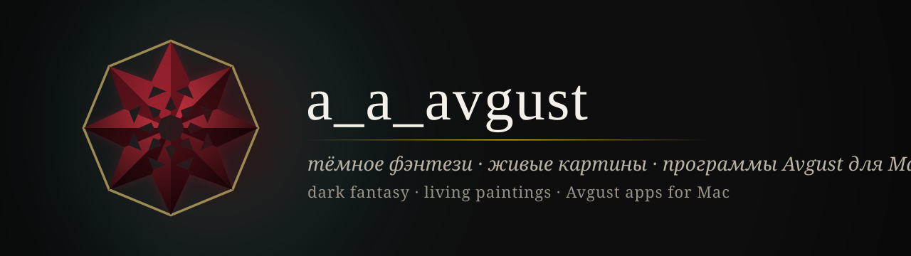
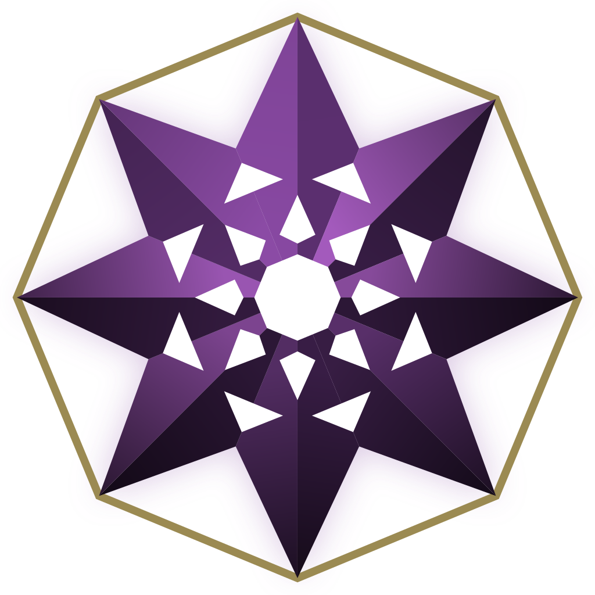
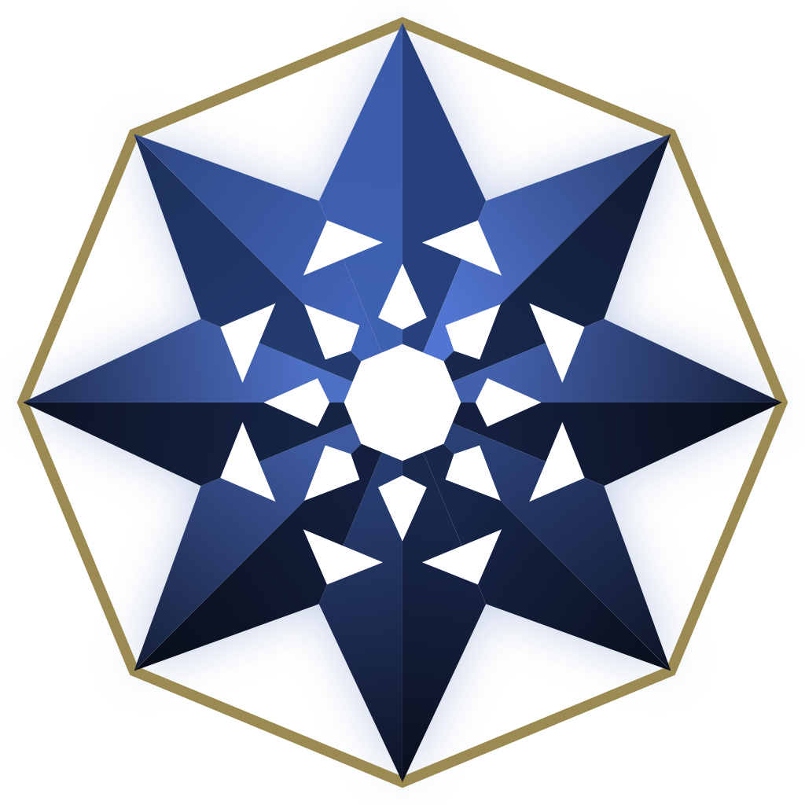

<picture>
  <source media="(prefers-color-scheme: dark)" srcset="assets/banner-dark.svg">
  <source media="(prefers-color-scheme: light)" srcset="assets/banner-light.svg">
  
</picture>

  <i>Островки света во тьме: ожившие картины, тёмное фэнтези и тихие программы, которые просто работают.</i> 
  Islands of light in the dark: living paintings, dark fantasy and quiet apps that simply work.

  <a href="https://aaavgust.github.io"><b>Сайт · Site</b></a> &nbsp;·&nbsp;
  <a href="mailto:a_a_avgust@icloud.com"><b>a_a_avgust@icloud.com</b></a>

---

### ✦ Семья Avgust · The Avgust family

<table>
  <tr>
    <td width="96" align="center"></td>
    <td>
      <b><a href="https://github.com/aaavgust/AvgustFamiliar">Avgust Familiar</a></b> — спокойный помощник для Mac в строке меню. 
      A calm menu-bar helper for your Mac. 
      <a href="https://github.com/aaavgust/AvgustFamiliar/releases/latest">Скачать · Download</a>
    </td>
  </tr>
  <tr>
    <td width="96" align="center"></td>
    <td>
      <b><a href="https://github.com/aaavgust/AvgustArkstone">Avgust Arkstone</a></b> — локальный ИИ, который живёт на вашем диске: чат, код, картинки, голос и база знаний без интернета. 
      Local AI that lives on your drive: chat, code, images, voice and an offline knowledge base. 
      <a href="https://github.com/aaavgust/AvgustArkstone/releases/latest">Скачать · Download</a>
    </td>
  </tr>
  <tr>
    <td width="96" align="center"></td>
    <td>
      <b>Avgust Herald</b> — скоро. Публикация работ по расписанию прямо с Mac. 
      Coming soon. Scheduled publishing straight from your Mac.
    </td>
  </tr>
</table>

---

### ✦ Принципы · Principles

- **Мгновенно.** Никаких подвисаний и лишней нагрузки в простое. · *Instant, idle means idle.*
- **Приватно.** Ваши данные остаются у вас. · *Your data stays yours.*
- **Красиво.** Тёмная палитра, живописный свет, ничего лишнего. · *Dark palette, painterly light, nothing extra.*

© a_a_avgust

